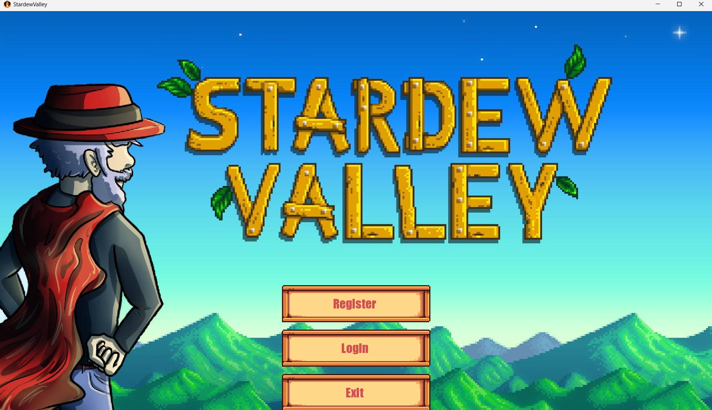
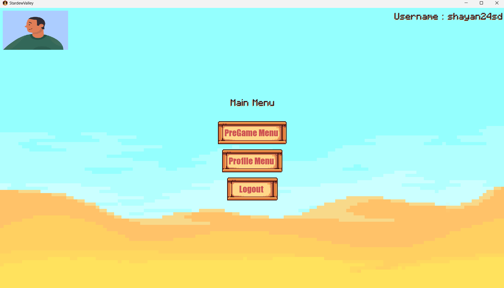
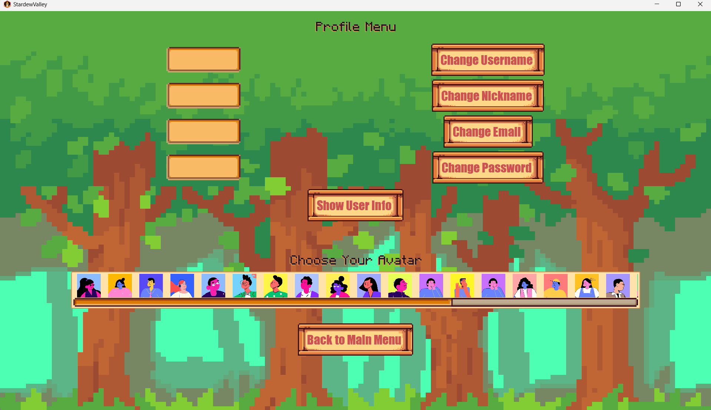
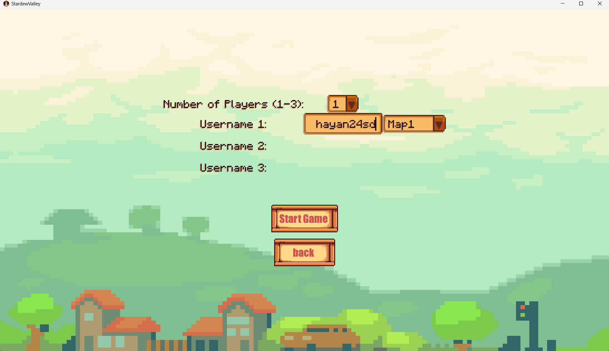
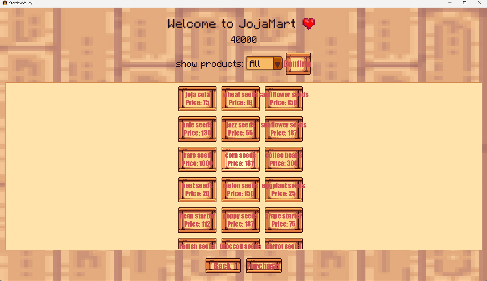
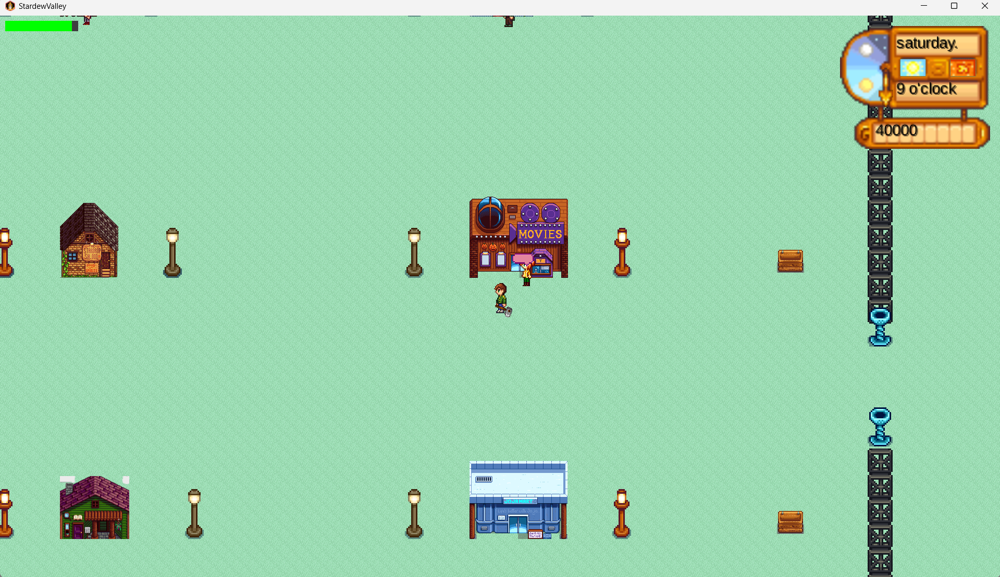
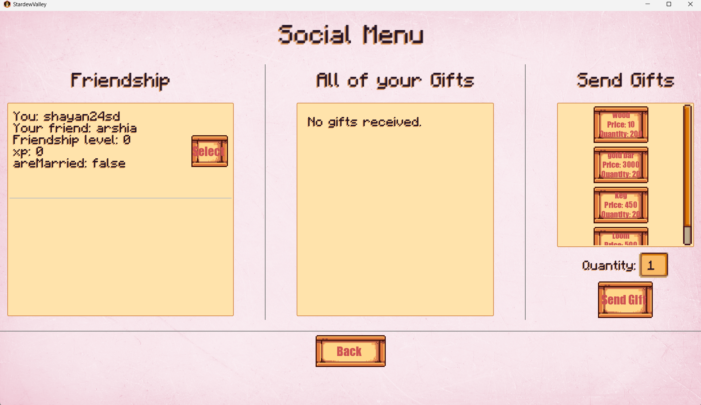
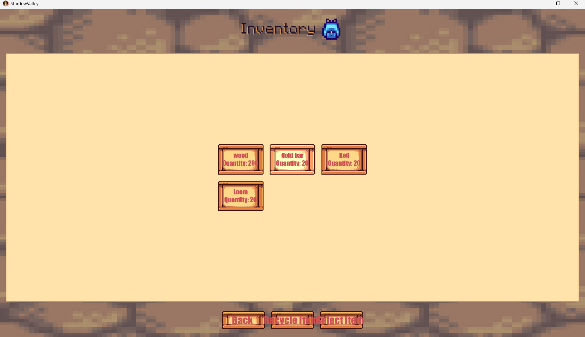
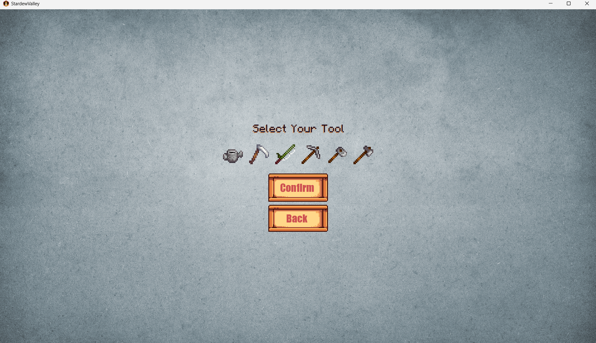

# Stardew Valley Clone

A 2D farming simulator inspired by *Stardew Valley*, built in Java with [libGDX](https://libgdx.com/) as a team project for the Advanced Programming course.


## Features

- **Accounts & profiles:** register/login, avatar selection, and editable username, nickname, email, and password
- **Multiplayer:** up to 3 players per game, with a choice of map
- **Farming:** plant, water, and harvest crops and trees; forage for wild items
- **Tools & skills:** watering can, scythe, pickaxe, axe, and more, with upgrades and skill levels
- **Fishing & animals:** catch fish, build barns and coops, raise farm animals
- **Crafting & cooking:** recipes and artisan machines (keg, loom, bee house, and more)
- **Economy:** shops such as JojaMart and player-to-player trading
- **Social:** NPCs (e.g. Robin) with quests and rewards, gifts, friendship levels, and marriage
- **World simulation:** day/night cycle, seasons, weather, and an energy system

## Screenshots

| | |
|---|---|
|  |  |
|  |  |
|  |  |
|  |  |
|  |  |

## Tech Stack

Java · libGDX · Gradle (LWJGL3 desktop backend)

## Getting Started

**Requirements:** JDK [version]

```bash
git clone https://github.com/shayan24soley85/adv-programming-stardew-valley.git
cd adv-programming-stardew-valley
./gradlew lwjgl3:run
```

On Windows, use `gradlew.bat lwjgl3:run`.

### Useful Gradle tasks

- `lwjgl3:run`: starts the game
- `lwjgl3:jar`: builds a runnable JAR in `lwjgl3/build/libs`
- `build`: builds sources and archives of every module
- `clean`: removes `build` folders
- `test`: runs unit tests

## Project Structure

- `core/`: main module with the game logic shared by all platforms
- `lwjgl3/`: desktop launcher (LWJGL3)
- `assets/`: textures, fonts, and other resources

The project was generated with [gdx-liftoff](https://github.com/libgdx/gdx-liftoff).

## Team

Developed by Amirshayan Soleimani Nia, Sina Aghaee Hakak, and Arshia Arab Behjat.
My contribution: [what you built, e.g. "farming, tools, and the store system"].
